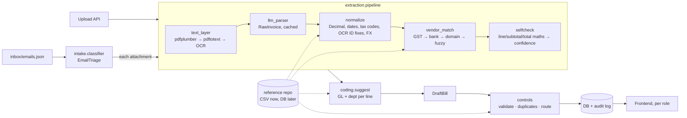

# Architecture

## Boundaries
- **Person A** returns a `DraftBill` (or an `ExtractionOutcome` saying why not). Stops before any judgement.
- **Person B** takes a `DraftBill` + reference data and returns a `ControlsResult`. Pure functions, no LLM.
- **DB team** stores everything, enforces roles on every endpoint, and writes an `AuditEvent` per state change.

## Data flow details
| Step | Module | Input → Output |
|---|---|---|
| Triage | `intake/classifier.py` | email dict → `EmailTriage` |
| Text | `extraction/text_layer.py` | bytes + filename → `TextResult(text, was_ocr, method, warnings)` |
| Parse | `extraction/llm_parser.py` | text or image → `RawInvoice` (strings as printed) |
| Normalize | `extraction/normalize.py` | strings → `Decimal`, `date`, `TaxCode`, province |
| Vendor | `extraction/vendor_match.py` | `VendorOnInvoice` + sender → vendor_id, method, score |
| Check | `extraction/selfcheck.py` | `DraftBill` → `field_confidence`, `extraction_warnings` |
| Code | `coding/suggest.py` | `DraftBill` → lines with `CodingSuggestion` |
